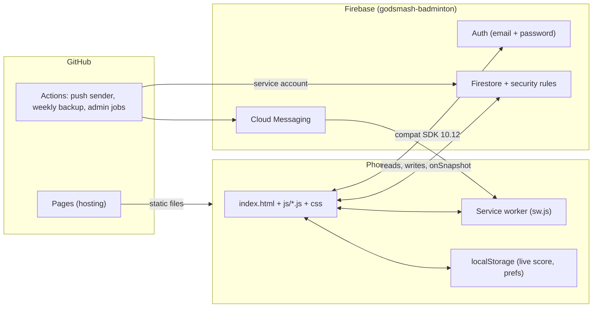
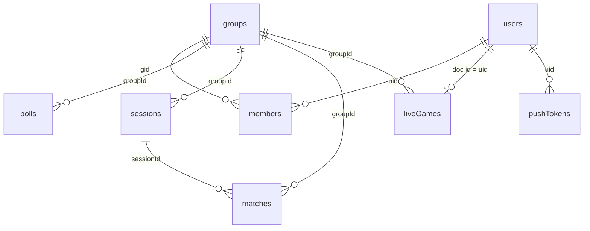

# Godsmash — System design

Overview of how the app is built and why. Written at **v121**. For how each feature is used see
[know-how.md](know-how.md); for per-feature specs and plans see `docs/superpowers/`.

- App: https://phounsiris-sketch.github.io/bughunters/
- Repo: `phounsiris-sketch/bughunters` (this project: `pm-hub-it-addon/projects/bughunters`)
- Backend: Firebase project `godsmash-badminton` (Firestore + Auth + Cloud Messaging, free Spark plan)

---

## 1. Goals and constraints

| Goal | Consequence |
|---|---|
| A badminton club app for phones (and an iPad scoreboard): polls, sessions, bill splitting, live score, stats | One installable PWA, mobile first |
| Free to run | No servers: Firestore + Auth on the free plan, GitHub Pages for hosting, GitHub Actions for jobs |
| Small team, fast change | No build step, no framework: plain JavaScript files loaded in order from `index.html` |
| Lao and English | Every string goes through `i18n.js`, both languages kept in step |
| Never lose money data | Confirm every destructive tap, trash with undo, weekly backup |

Non-goals: real payments (the subscription step is a demo), server-side logic beyond the scheduled jobs.

---

## 2. Architecture



- **Client only.** All logic runs in the browser. Firestore security rules are the real permission layer;
  `perms.js` mirrors them only to hide buttons.
- **Static hosting.** `.github/workflows/pages.yml` copies `index.html`, `manifest.json`, `sw.js`, `css/`, `js/`,
  `icons/` into `public/` and deploys on every push to `main` (about 1–5 minutes). There is no staging site.
- **Jobs in GitHub Actions** (`push/*.js`, Node + `firebase-admin`, service account in a repo secret):

| Workflow | What |
|---|---|
| `push.yml` | Reads new events, sends web pushes through FCM (about every 5 minutes) |
| `backup.yml` | Weekly Firestore backup (Sunday 20:17 UTC) |
| `restore-backup.yml` | Admin: restore from a backup run |
| `migrate-groups.yml` | Admin, once: put old data into a group |
| `merge-players.yml` | Admin: merge two player records |

---

## 3. Runtime and loading

`index.html` loads, in this order: splash markup and `js/splash.js` (first, so the scene starts at once), the
Firebase compat SDKs from the CDN, then `firebase-config.js`, `i18n.js`, `router.js`, `db.js`, `perms.js`,
`groups.js`, `storage.js`, `auth.js`, and the feature modules, ending with `app.js`. Modules share globals
(`currentUser`, `currentGroupId`, `lastSessions`, `lastMatches`, `DB_CACHE`, …). **Script order matters**.

Start-up path:

1. `splash.js` draws the opening scene on one canvas (see section 8).
2. `app.js` → `initAuth()` → `auth.onAuthStateChanged`.
3. Signed out: `showAuthPage()`. Signed in but email not verified: verify screen. Otherwise `_afterSignIn(user)`
   loads `users/{uid}`; a missing profile asks for a name.
4. `_enterApp()` → `loadGroupContext()` (my `members` docs, then each `groups` doc, pick the current group) →
   `startGroupListeners()` → `initApp()` (shared data cache) → `showAppPage()`.
5. `hideSplash()` waits until the scene's minimum time has passed (1.0 s, 0.5 s with reduced motion); a tap skips it;
   an 8 s fallback hides it regardless.

Failures at step 4 are reported by `_authFail(step, error)` ("Sign-in stopped (step): message") instead of a dead
form, and a 12 s watchdog warns if the app never opened.

### State and data flow

- **Real-time listeners** (`onSnapshot`) per collection keep module-level arrays up to date
  (`lastPolls`, `lastSessions`, `lastMatches`, …) and call `refreshCurrentPage(reason)` to re-render the open page.
- **Rendering** is string templates written into containers (`innerHTML`); there is no virtual DOM. Handlers are
  inline `onclick` calls to global functions.
- **Sorting and filtering happen in the browser**, so no composite Firestore indexes are needed.
- **Offline cache:** Firestore persistence is on, except on iOS (see section 9, "iPad session").

---

## 4. Module map

| Area | Files |
|---|---|
| Shell | `app.js` (entry, refresh, modal, version), `router.js` (pages, splash hide), `ui.js` (shared components, UI rules), `icons.js` (Solar icon set, inline SVG), `select.js`, `datepicker.js` |
| Accounts and groups | `auth.js`, `groups.js` (many groups, invite codes, roles), `perms.js`, `subscription.js` (demo only), `people.js`, `profile.js`, `social.js` (play buddies, reports) |
| Planning and money | `polls.js`, `sessions.js` (costs, split, who pays whom), `payments.js`, `dashboard.js` (balance, spending, activity), `restaurants.js`, `maps.js` |
| Playing | `livescore.js` (counting, watch, match formats), `games.js` (one list for votes and sessions), `stats.js` (matches, ratings, badges), `public.js` (open games) |
| Platform | `db.js` (CRUD helpers + shared cache), `storage.js` (images as data URLs), `trash.js` (30-day undo), `notify.js` (in-app), `push.js` (device tokens), `splash.js` |
| Text | `i18n.js` (English + Lao) |

---

## 5. Data model (Firestore)

Details per field are in [know-how.md section 12](know-how.md). Summary of how things connect:



- **Everything private carries `groupId`.** Membership is the document `members/{gid}_{uid}` with `role`
  (owner / admin / member), `perms` (createPoll, editSession, editBill, editConfig) and `status` (active / pending).
- **Polls** plan a game; a confirmed poll becomes a **session**. A session holds players, costs, payers, dinner and
  settlement, and has many **matches**.
- **A match = one game** (`games: [{a, b}]`, one record per game; Firestore has no nested arrays).
  Live-counted games are saved with `live: true`; `createdBy` is who counted or typed it.
- **`liveGames/{uid}`** is the shared scoreboard of whoever is counting (section 7). One document per host.
- **`trash/{id}`** receives deleted documents; the push job purges after 30 days. **`images/{id}`** stores
  compressed images referenced as `img:<id>`.

### Security rules (`firestore.rules`)

- Helpers: `isAuth`, `isSuper` (the app owner by verified e-mail), `isMember(gid)`, `isGroupAdmin(gid)`,
  `canIn(perm, gid)`, `isCreator()`.
- Group data: members read; writes need the matching `perm`, or being the creator, or admin.
- `liveGames/{uid}`: group members read; only the owner creates, updates or deletes (`hostId == auth.uid`).
- Public collections (`courts`, `openGames`, `restaurants`, `gear`) are readable by any signed-in user.
- **Rules are published by hand** in the Firebase console. A new rule in the repo does nothing until it is pasted
  and published (this has hidden features before: a red "Database blocked [name]" bar means a missing rule).

---

## 6. Authentication

Firebase Auth, email + password, with email verification. Register creates the account, saves a `pendingProfile`
in `localStorage`, sends the verification mail, and writes `users/{uid}` once the mail is confirmed. A new account
passes the demo subscription step before the app opens. Mail requests are limited to one per minute per kind
(`godsmash_mail_*`). `auth.setPersistence(LOCAL)` keeps the session after closing the tab.

---

## 7. Live score

One person counts on a phone; others (an iPad, other members) can watch.

```mermaid
sequenceDiagram
  participant H as Host phone
  participant F as Firestore liveGames/{hostUid}
  participant W as Watcher (iPad / member)
  H->>H: lsTap(side, ±1) → state `live`, saved to localStorage
  H->>F: lsShare() (debounced set)
  F-->>W: onSnapshot → _lsWatchHtml()
  H->>H: game over → summary / save
  H->>F: lsSaveGame → matches.add(); state reset; lsShare()
  H->>F: finish / exit → lsUnshare() (delete)
  F-->>W: document gone → "ended", watch screen closes
```

### State (`live`, local `godsmash_live_v1`)

`sid, type, a[], b[], sa, sb, serve, hist[], over, startedAt, saved, bo, sw{A,B}, gl[{a,b}], test`

- `sa/sb` points; `serve` side; `hist` for Undo; `over` = winning side once the game is decided.
- `bo` format: `1` single game, `2` **Rematch** (two games), `3` **best of 3**. `sw` games won, `gl` finished games.
- `test` = practice game: shared so the watch screen can be tried, **never saved** to `matches`.

### Rules

- Rally scoring to 21, 2-point lead, cap at 30 or 31 (the group's `maxPoints` setting; `lsApply`, `lsGamePoint`).
- `lsMatchDecided`: best of 3 → first to 2 games; Rematch → both games are played, 2–0 wins, **1–1 is a draw**.
- `_lsEnd(state)` says what just ended: `game` (match goes on), `match` (single game, or deciding game),
  `draw`. The UI follows it: game → medal, match → trophy, draw → medal on both sides.
- `_lsShown(state)`: the finished game already counts in the games-won card before it is saved.
- Save: each game becomes one `matches` doc (`live: true`, `createdBy`, `confirmed: false`). When a match is over, a
  **summary page** (every game, match score) must be confirmed; Save-and-finish clears all live state.
- Every destructive tap (Reset all, Exit, Cancel game) asks first (rule documented in know-how).

### Sharing

- `lsShare` writes the board (`hostId, dev, groupId, sid, type, a, b, test, bo, sw, gl, sa, sb, serve, over, saved,
  theme, startedAt, updatedAt`). `dev` is a per-device id so the same account on another device still sees it.
- Boards older than 3 h (`LIVE_STALE_MS`) are ignored; boards of ended or cancelled sessions are hidden (`_liveEnded`).
- Watchers: Home shows "Live now" (`liveNowHtml`) and `lsWatch(id)` opens a read-only full-screen board.

### Screens and layout

- Counting screen: two halves (A / B), tap zones for + and −, a middle bar (Undo, "Game N", Settings), a menu
  (Exit, Reset all, Settings, Fullscreen). Phones (width ≤ 767 px or height ≤ 500 px) show a minimal version: no team
  text, no match line, no top Exit.
- Watch screen (iPad): large score, big serving shuttle, match card + per-game points, landscape layout.
- Winner effects: glow, score pop, confetti, a medal or trophy that pulses behind the score (never moves the score).
  `prefers-reduced-motion` turns the animation off.
- Zoom is blocked on the live screen (`touch-action: manipulation`, `gesturestart` prevented) so fast taps count.

---

## 8. Splash

`js/splash.js`: one `<canvas>`, every frame a pure function of time (`draw(real)`), so it can be paused and
inspected (`spSeek(ms)`, `spStop()`). Scene: a gauntlet swings in, smashes a shuttle into the logo, brief hit-stop,
flash, shock ring, cracks, shards fall away. Red or blue, alternating each launch (`godsmash_splash`).

- Plays at `SPEED = 2.2` (about 1 s), minimum on screen 1.0 s (`SPLASH_MIN_MS` in `router.js`).
- Canvas pixel budget about 1.6 MP (tablets would otherwise draw ~4 MP a frame).
- Reduced motion: one still frame. A tap skips. `docs/splash-preview.html` previews the scene.

---

## 9. PWA, caching and versions

- `sw.js`: network-first for the app files with a precache list (`ASSETS`), plus the push handlers.
- **Versioning:** `APP_VERSION` (js/app.js) and `CACHE_NAME` (sw.js) are bumped together on every release. After a
  deploy the first open fetches the new files and the second open runs them ("open it twice").
- **iPad / iOS session:** Safari's IndexedDB can hang or be wiped (also: site data of unused tabs is purged after
  7 days; Home Screen apps are exempt). So `IS_IOS` skips Firestore offline persistence, and the auth session is set to
  `LOCAL` persistence. Advice to users: add the app to the Home Screen.
- Web push: `push.js` saves the device token; the scheduled `push/send.js` sends through FCM; the service worker shows
  every message itself (iOS revokes push that stays silent).

---

## 10. UI system

Rules every screen follows (also in `ui.js`):

1. A picture before words (bar, ring, dot, icon).
2. A person is always a photo **and** a name (`personHtml`, `peopleHtml`).
3. Light and dark tokens (CSS variables), several colour themes (Court, Royal, …); iOS safe-area insets.
4. Every reset, quit or cancel asks for confirmation, even at 0–0.
5. Lao and English strings together: add the key in both languages (parity is kept by hand).
6. Icons are the embedded Solar set (`icon(name, size)`); new icons are added to `SOLAR` in `icons.js`
   (the trophy was drawn for the live score).

---

## 11. Release process

```
branch (feat/… or fix/…) → bump APP_VERSION + CACHE_NAME together
→ rm -f typescript ; sh tools/release-guard.sh   (empty tracked files, version equality, node --check, sw handlers)
→ update docs/know-how.md (+ spec/plan for features) → commit → push branch
→ user reviews, says "merge" → merge into main → push → Pages deploys
```

- No direct commits to `main` for features; a review step, then "merge". Branches stacked on each other deploy
  together when the top one is merged.
- Tests are throw-away Node scripts with stubs (`/tmp`) and headless Chrome screenshots; there is no test suite in the
  repo. QA checklists: `docs/qa/`.
- A stray empty `typescript` file keeps appearing in the project root (cause unknown); it is git-ignored and the
  guard fails if it is tracked.

---

## 12. Known limits and open items

| Item | Note |
|---|---|
| Firestore rules are manual | Publish `firestore.rules` after every change; `liveGames` needed for the watch feature |
| No staging environment | Every merge goes live |
| Subscription | Demo only, nothing is charged |
| iPad sign-in | Fixed twice (clear error messages, no IndexedDB cache on iOS); cause not confirmed on a real device |
| Lao wording | New labels from v89 on are not reviewed by a Lao speaker |
| Scorekeeper badge | Counts games a player created (50); verify with real data |
| Script bundling | About 30 script tags loaded in order; bundling and tablet/desktop layout are open follow-ups |
| `lspick_test` / `set_test` (throw-away) | Need stub updates for the same-pairs behaviour |
